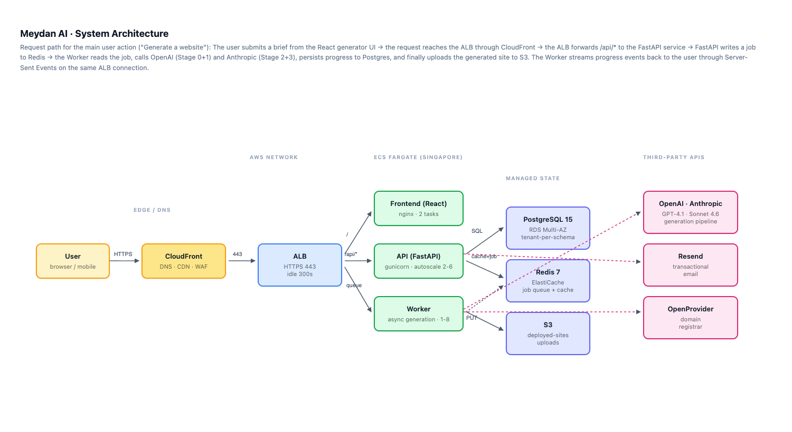

# 2. Architecture Diagram

**Editable source**: `assets/diagrams/architecture.html` — open in any browser to inspect or edit.

## Caption — request path for the main user action

A user submits a generation brief from the React UI. The request leaves their browser as HTTPS to CloudFront (the authoritative DNS), which proxies it to the ALB in `ap-southeast-1`. The ALB routes by path:

- `/` and the dashboard → **Frontend** service (nginx + React build, 2 tasks)
- `/api/*` → **API** service (FastAPI + gunicorn, 2-6 tasks autoscaling on CPU)

The API persists the request to PostgreSQL, enqueues a generation job in Redis, and returns immediately. The user's browser opens a Server-Sent Events stream to the same ALB; the API streams progress events back as the job advances.

The **Worker** service consumes the Redis queue and runs the four-stage generation pipeline:

1. **Stage 0 (Enhance)** — GPT-4.1-mini expands the brief into a creative brief (~2 s, ~1.5K tokens)
2. **Stage 1 (Plan)** — GPT-4.1 produces a JSON plan with brand tokens and section layout (~7 s)
3. **Stage 2 (HTML)** — Claude Sonnet 4.6 emits the full Tailwind-styled HTML (~50 s, the heaviest stage)
4. **Stage 3 (JS)** — Claude Sonnet 4.6 emits vanilla JS interactions (~20 s)

The Worker writes generated artefacts to a tenant schema in PostgreSQL and uploads the deployable artefact bundle to S3 (`meydan-prod-sites-sg`). The frontend then loads the result; the user can edit and redeploy from the editor.
