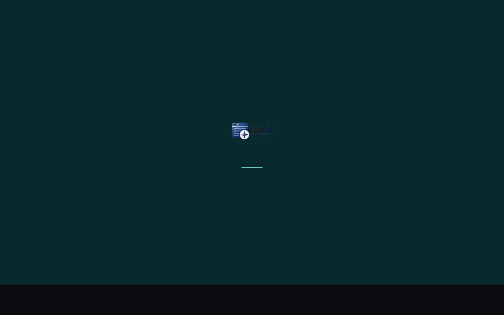
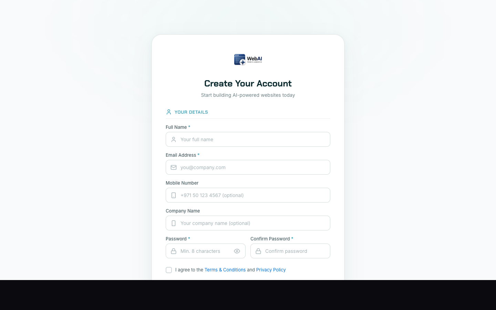
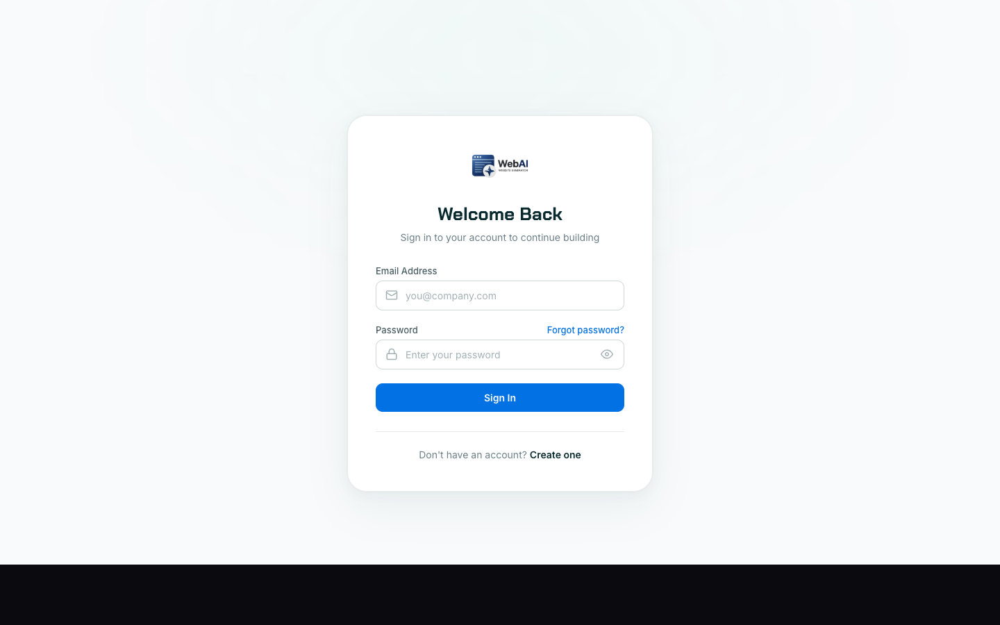

# 3. User Workflow

End-to-end journey of a real user from first visit to a deployed website.

## Step 1 — Land on the marketing site

**User does**: visits `https://meydanfzai.com`.
**System does**: CloudFront serves the React-built landing page from the Singapore ALB.
**User sees**: hero + animated demo + CTA to "Get Started".

## Step 2 — Sign up

**User does**: clicks **Get Started** → fills the signup form (full name, work email, password, company name, trade-licence number).
**System does**: `POST /api/auth/signup` validates the payload (12-char strong password, RFC-5321 email), creates a `public.users` row with `is_approved=false` and `tokens_balance=0`, creates a `tenant_<sanitised_email>` schema, and emails a verification link via Resend.
**User sees**: a "check your inbox" screen.

## Step 3 — Verify email

**User does**: clicks the link in their inbox.
**System does**: `GET /api/auth/verify-email?token=…` flips `email_verified=true` and redirects to login.
**User sees**: a success banner that says they can now log in once approved.

## Step 4 — Pending approval

**User does**: tries to log in.
**System does**: `POST /api/auth/login` returns a JWT, but the `pending_approval` flag in the response routes the UI to a "waiting room" page. No tokens to spend yet.
**User sees**: a friendly screen explaining that an admin will approve them shortly.

## Step 5 — Log in (post-approval)

**User does**: refreshes after the admin approves them. Logs in normally.
**System does**: same `POST /api/auth/login`; this time `pending_approval` is false, JWT routes to `/dashboard`.
**User sees**: the dashboard with an empty sites list and a primary CTA "Generate a new site".

## Step 6 — Submit a brief

**User does**: clicks **Generate** → picks a niche from the dropdown → writes a 1-3 sentence brief about their business → clicks **Generate**.
**System does**: `POST /api/generator/generate-stream` runs keyword + LLM moderation; if the prompt is safe, opens a Server-Sent Events stream and enqueues the four-stage pipeline.
**User sees**: a streaming progress UI ("Enhancing brief…", "Planning sections…", "Designing pages…", "Adding interactions…").

## Step 7 — Edit in the workspace

**User does**: lands in the editor; can chat with the AI to adjust copy, swap images, change colours; or open the Monaco code panel directly.
**System does**: each chat instruction hits `POST /api/sections/{id}/edit`, which runs an LLM-based diff against the section and returns the patched HTML/CSS/JS.
**User sees**: a live preview that updates as edits land.

## Step 8 — Deploy

**User does**: clicks **Deploy**.
**System does**: `POST /api/deploy` packages the site, uploads to `meydan-prod-sites-sg` S3 bucket with a unique slug, and returns the public URL `https://<slug>.s3-website.ap-southeast-1.amazonaws.com`. If the user has a custom domain, CloudFront DNS is updated and an ACM certificate is requested.
**User sees**: a success modal with the live URL and a "View site" button.

## Error states

| Trigger | User-visible message | Recovery path |
|---|---|---|
| Pre-gen moderation rejects prompt | "[RESTRICTED] Content safety check is temporarily unavailable. Please try again shortly." (or category-specific reason if keyword check fired) | User edits the brief and retries. Operator can flip `MODERATION_LLM_ENABLED=false` for outages. |
| LLM circuit breaker open | "Generation service is recovering. Try again in 60 seconds." | 60-second wait; recovery is automatic. |
| Token balance exhausted | "You've used your monthly generation quota. Contact support to top up." | Admin grants tokens via the admin panel. |
| Generation hits stage timeout (300s) | "Generation took too long. We've kept your draft — try editing or regenerating a single section." | Saved draft in DB; user can resume from the editor. |
| S3 deploy failure | "Deployment failed. Your site is saved — try again or contact support." | The plain message is shown; the full traceback is in CloudWatch with the correlation ID returned in the response header. |
