# 4. Admin Workflow

How an operator runs the product day-to-day. The admin panel is laid out in seven sections — **Dashboard**, **Sites & Generation**, **Domains**, **Users**, **Tokens**, **Operations**, **Analytics**.

## Step 1 — Log in as admin

**Admin does**: visits `https://meydanfzai.com/admin/login`, enters admin credentials.
**System does**: `POST /api/auth/login` issues a JWT; if `is_admin=true` the UI exposes the admin sidebar at `/admin/*`.

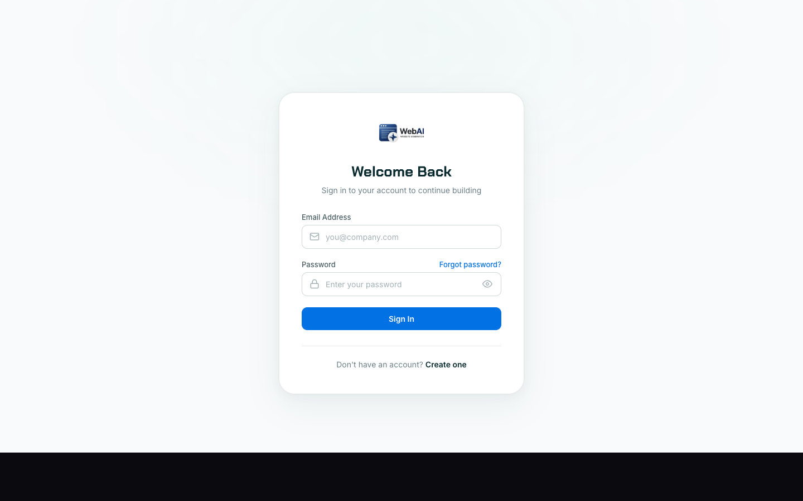

## Step 2 — Read the Overview

**Where**: `/admin/overview` (default landing page).
**What it shows**: total users, generations in queue, system uptime, system health, platform growth (30d), generation success rate, API circuit breakers, infrastructure usage (memory / CPU / Redis / DB pool), recent users, recent generations.

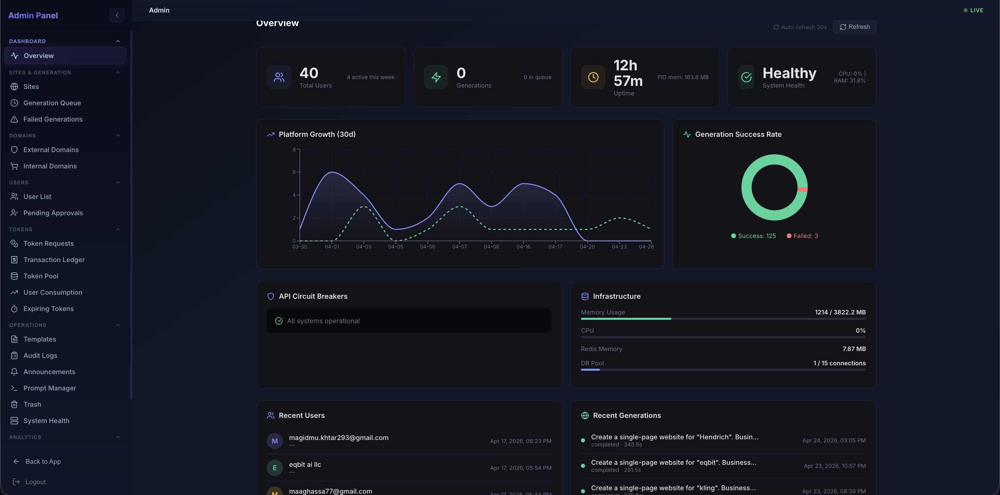

## Step 3 — Find a user (User List & Consumption)

**Where**: `/admin/users` (sidebar **Users → User List**) — also doubles as the consumption table.
**Admin does**: searches by email, name, or company; columns include granted tokens, used tokens, balance, generations, edits, last active, recent burn rate.
**API**: `GET /api/admin/users?q=…&page=…`.

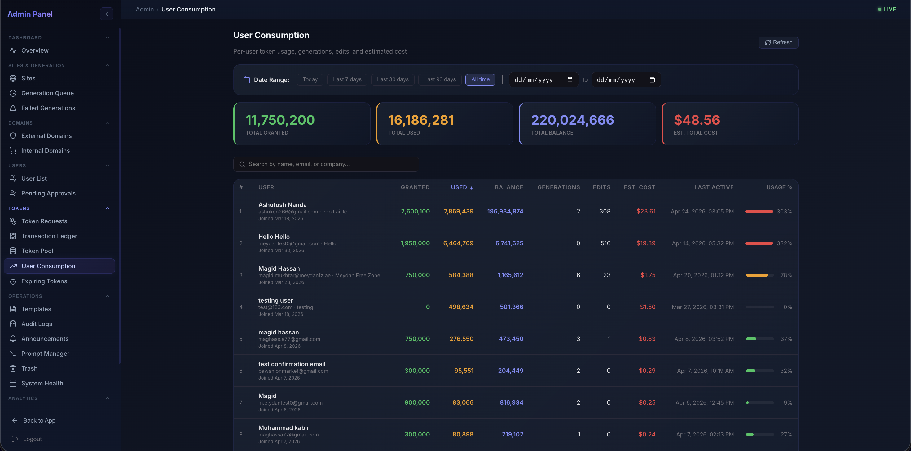

## Step 4 — Open a user and adjust them

**Where**: click any user → `/admin/users/{id}`.
**What it shows**: header with the user's email and a row of action buttons — **Disable**, **Make Admin**, **Reset Password**, **Impersonate**, **Annul**, **Grant**. Tabs underneath (Overview / Sites / Tokens / Logins / Audit). Profile data: full name, ID, mobile, schema name, generation count, edits, approval state, token balance, projects.
**API**:
- `GET /api/admin/users/{id}` — detail
- `POST /api/admin/users/{id}/grant-tokens` — `{amount, reason}` for top-ups
- `POST /api/admin/users/{id}/disable` — suspend user
- `POST /api/admin/users/{id}/make-admin` — flip `is_admin=true`
- `POST /api/admin/users/{id}/impersonate` — issue an impersonation JWT (audit-logged)
- `POST /api/admin/users/{id}/annul` — wipe user's tenant schema (irreversible — confirmation modal)

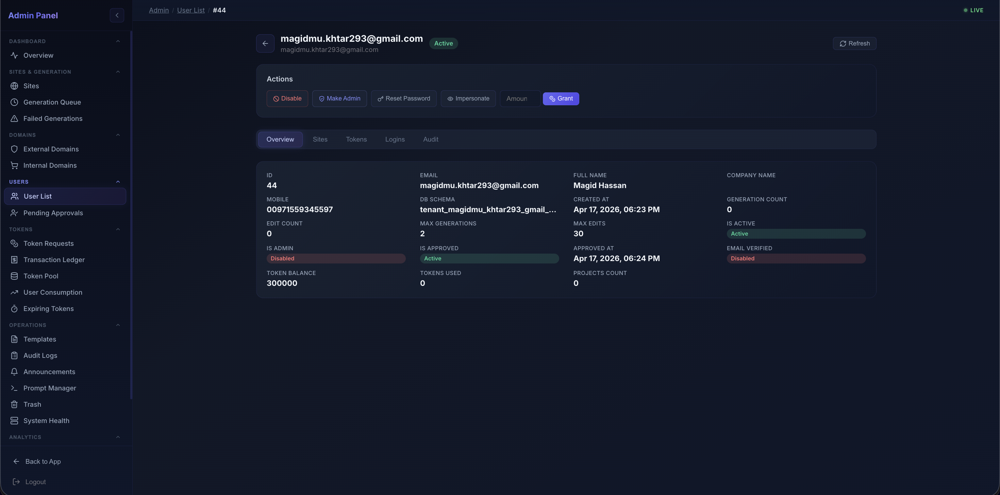

## Step 5 — Approve new signups

**Where**: `/admin/users/pending-approvals`.
**What it shows**: queue of users with `is_approved=false`. Empty when caught up — the screenshot below shows the all-clear state.
**API**:
- `POST /api/admin/users/{id}/approve` (auto-grants the welcome 1M tokens)
- `POST /api/admin/users/{id}/reject`

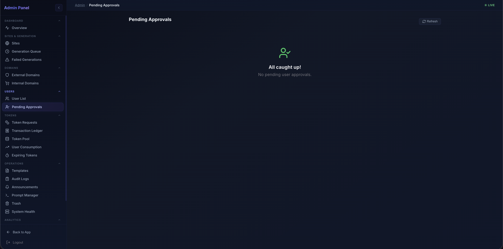

## Step 6 — Read current generation usage and cost

### In-product
- **Sidebar → Analytics → Generation Stats** (`/admin/analytics/generation-stats`): completed count, failed count, success rate, completion-breakdown donut, daily generations, failures-by-stage bar.

  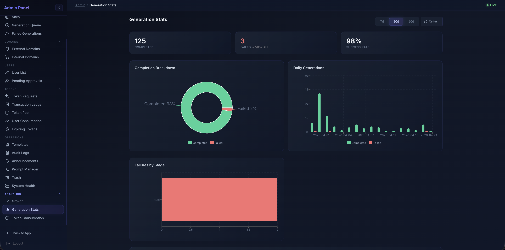

- **Sidebar → Analytics → Token Consumption** (`/admin/analytics/token-consumption`): consumed / granted / refunded / avg-daily-burn / utilisation, daily token activity, cumulative trend.

  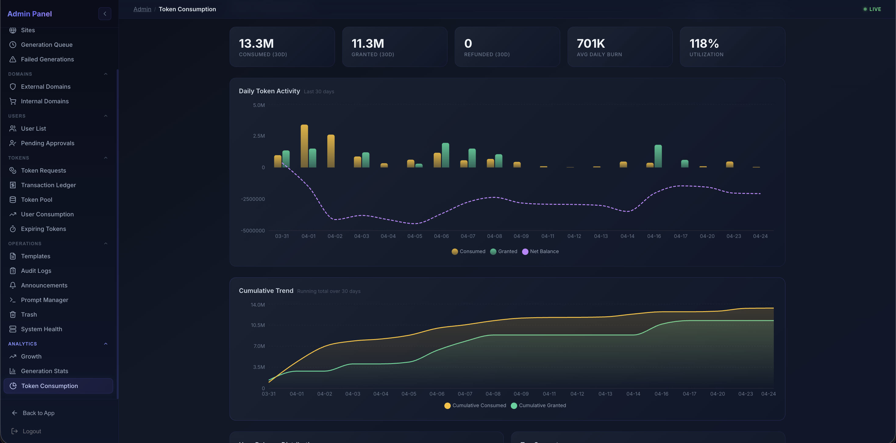

- **Sidebar → Analytics → Growth** (`/admin/analytics/growth`): total users, signups this week, active users, signups & active users over time, user-status donut.

  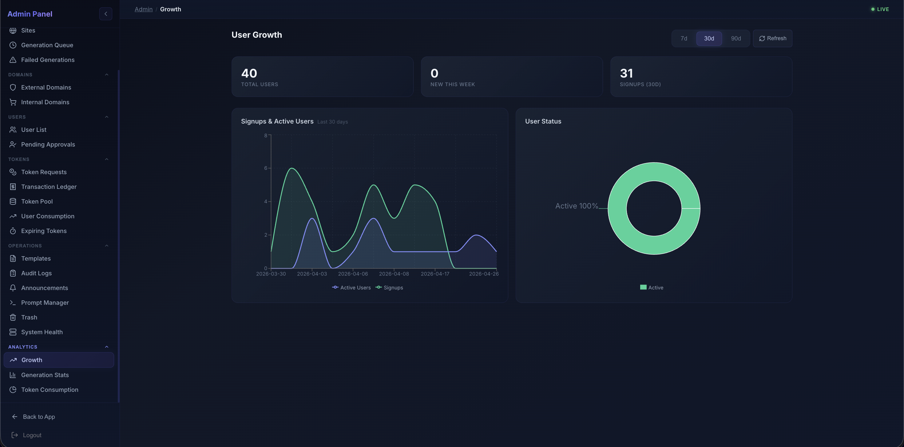

- **Sidebar → Operations → Templates** (`/admin/operations/templates`): the public template gallery — toggle templates on/off across categories.

  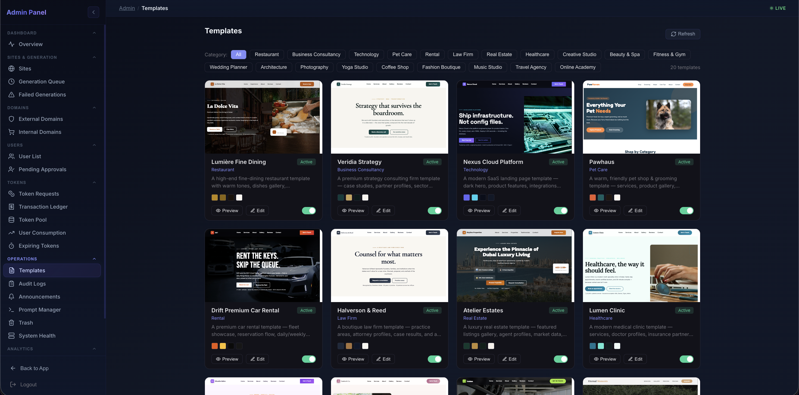

### External (authoritative for billing)
- **AWS Cost Explorer**, filtered by tag `Project=meydan-ai`, region `ap-southeast-1`.
- **OpenAI dashboard** under the production org — token usage and per-model spend.
- **Anthropic console** — same.
- **CloudWatch dashboard** in `ap-southeast-1`: `meydan-production` — request rate, p95, 5xx, ALB target health.

## Step 7 — Manage tokens (request queue, ledger, pools)

- **Sidebar → Tokens → Token Requests** — pending user requests for top-ups; admin approves / rejects.

  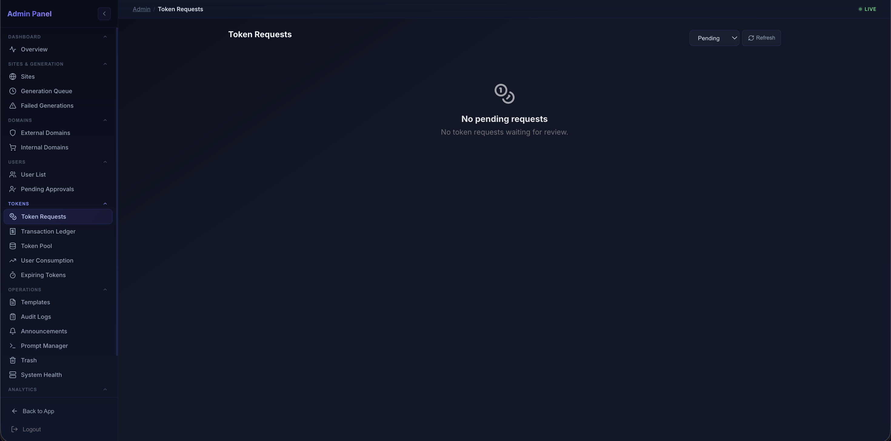

- **Sidebar → Tokens → Transaction Ledger** — every grant, consumption, refund. Searchable / filterable / CSV-exportable.

  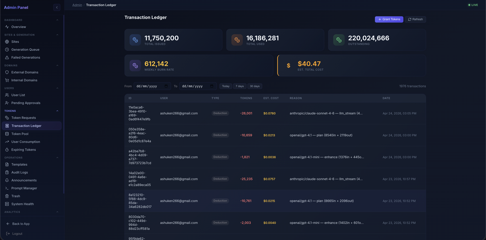

## Step 8 — Manage sites & deployments

- **Sidebar → Sites & Generation → Sites** — every published site across all tenants.

  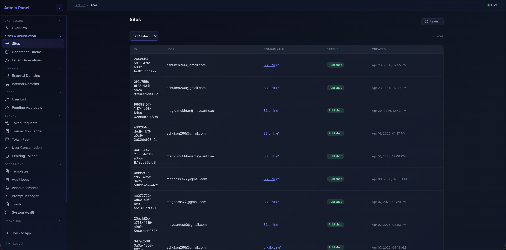

- Click into a site → tabs **Overview / Preview / Deployment History**:

  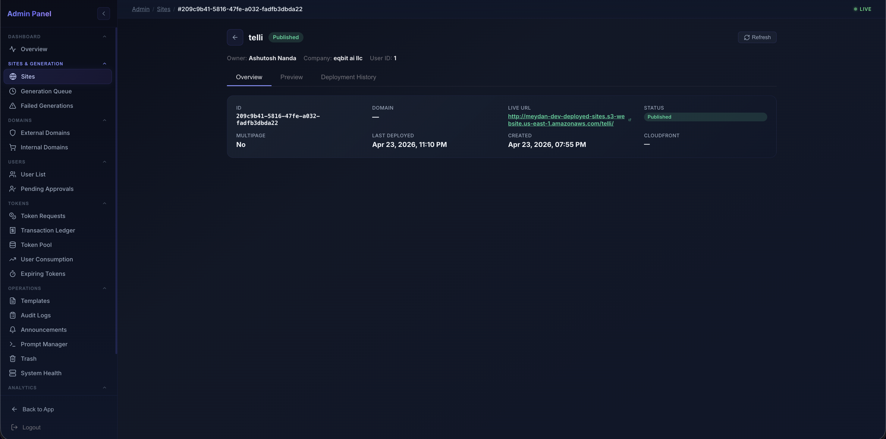
  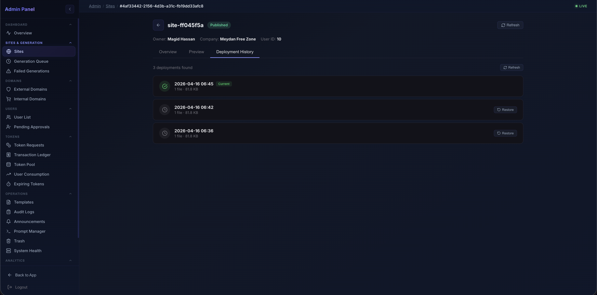

- **Sidebar → Sites & Generation → Failed Generations** — live Redis queue + DB-persisted failures, with retry buttons.

  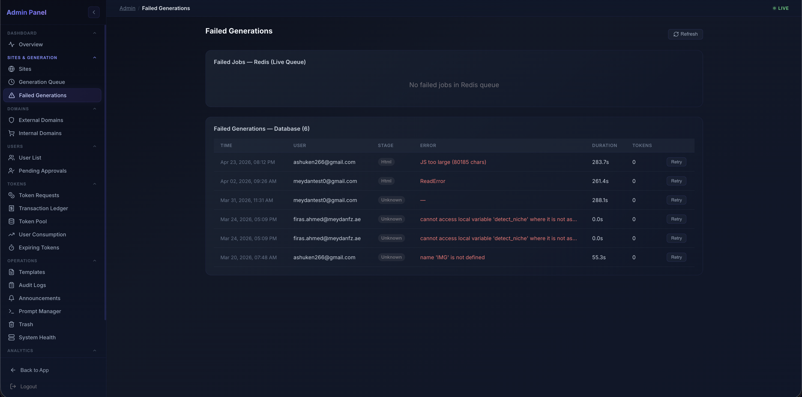

## Step 9 — Manage domains

- **Sidebar → Domains → External Domains** — customer-purchased domains via OpenProvider. Status / verification / SSL state.

  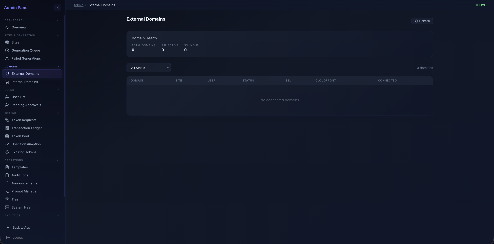

- **Sidebar → Domains → Internal Domains** — `*.meydanfzai.com` subdomains issued to tenants.

## Step 10 — Change a prompt or model (Prompt Manager — NOT YET WIRED)

> ⚠️ **Important — Prompt Manager is UI-and-storage only at handover. It is not wired into the live generation pipeline and has not been end-to-end tested.** Publishing a new version writes a row to `prompt_versions` in the DB but the Worker still reads hardcoded prompts from `backend/app/utils/prompt_pipeline.py`. To actually change a prompt today, edit `prompt_pipeline.py`, commit, and push to `main`. See "Unfinished items" in `10_known_issues_and_support.md` — this is the top item.

**What exists today (UI + DB only)**: **Sidebar → Operations → Prompt Manager** (`/admin/operations/prompt-manager`). You can pick a stage (Stage 0/1/2/3), browse the version history table, click **+ New Version**, paste the new system prompt, write a release note, **Publish**. The DB records the change. **Nothing in the live pipeline reads it.**

**Endpoints that work** (write to DB but don't affect generation):
- `GET /api/admin/prompts` — list stages and stored versions
- `POST /api/admin/prompts/{stage}/versions` — submit a new version
- `POST /api/admin/prompts/{stage}/versions/{id}/publish` — flag as active in DB
- `POST /api/admin/prompts/{stage}/versions/{id}/rollback` — flag previous as active in DB

**To finish the wiring** (~1 day of work):
1. In `backend/app/utils/prompt_pipeline.py`, replace the hardcoded prompt strings with a lookup function that reads the active version from `prompt_versions` and falls back to the in-file default if the DB has no published row.
2. Add a 60-second in-process cache so each generation request doesn't hit the DB.
3. Add a "preview generation with this draft prompt" admin endpoint so a new version can be smoke-tested before publish.
4. Cover with a unit test: publishing a known-good version routes the generation request through it; rolling back restores the previous prompt.

The model name is a metadata field on the version (already in the schema), so once wired the rollback restores both prompt text and model.

### What to do RIGHT NOW to change a prompt

Until the wiring is done, treat prompts as code:

```bash
# 1. Edit the prompt
$EDITOR backend/app/utils/prompt_pipeline.py

# 2. Commit + push to dev to test
git add backend/app/utils/prompt_pipeline.py
git commit -m "prompts: tighten Stage 2 hero contrast rule"
git push origin dev

# 3. Verify on dev (https://dev.meydanfzai.com or the dev ALB DNS) — generate one site
# 4. If it looks right, merge to main
git checkout main && git merge dev && git push origin main
```

CI builds the new image and rolls the prod ECS services within ~5 minutes.

## Step 11 — Read application logs and the audit trail

### Audit trail (in-product)
**Where**: **Sidebar → Operations → Audit Logs**. Every admin action plus auth events. Filterable by user.
**API**: `GET /api/admin/audit-log?from=&to=&q=&page=`.

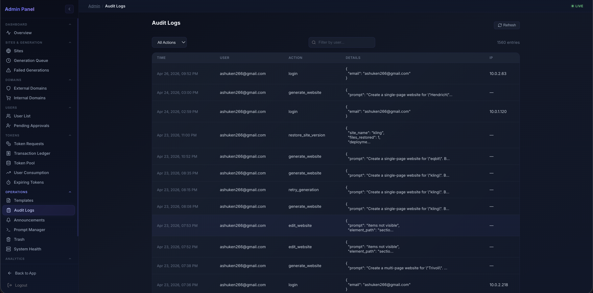

### Application logs (CloudWatch)
```bash
# Live tail (last 5 min, errors only)
aws logs tail /ecs/meydan-prod-api --since 5m \
  --filter-pattern '{ $.level = "ERROR" }' \
  --region ap-southeast-1 --profile prod

# Trace a specific user-reported issue (correlation ID is in the X-Correlation-ID response header)
aws logs tail /ecs/meydan-prod-api --since 30m \
  --filter-pattern '{ $.correlation_id = "0cf84c22-0c0f-47fe-b8e0-1ae8a667b7a3" }' \
  --region ap-southeast-1 --profile prod
```

## Step 12 — Inspect system health

**Where**: **Sidebar → Operations → System Health**.
**What it shows**: CPU, memory, disk, circuit breakers (Redis, Database Pool), Python / Linux version, uptime, process metrics, error rate, request count.

If a circuit breaker is open (e.g. OpenAI keeps timing out), reset with: `POST /api/admin/circuit/{openai|anthropic}/reset`.

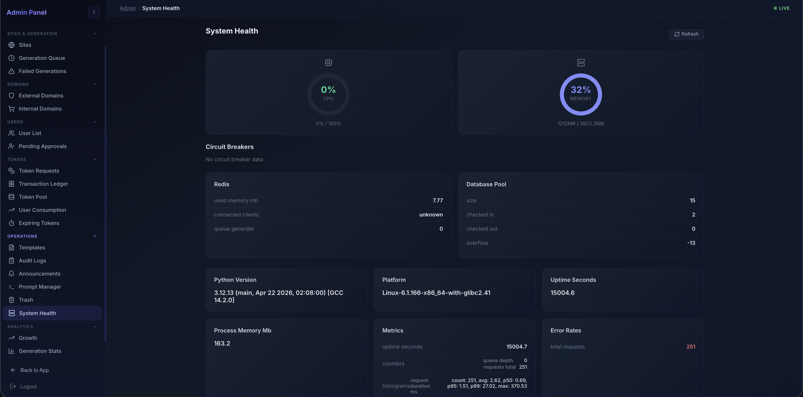

## Step 13 — Recover from accidents (Trash)

**Where**: **Sidebar → Operations → Trash**. Soft-deleted sites and projects, auto-purged after 15 days. Each row has **Restore**.

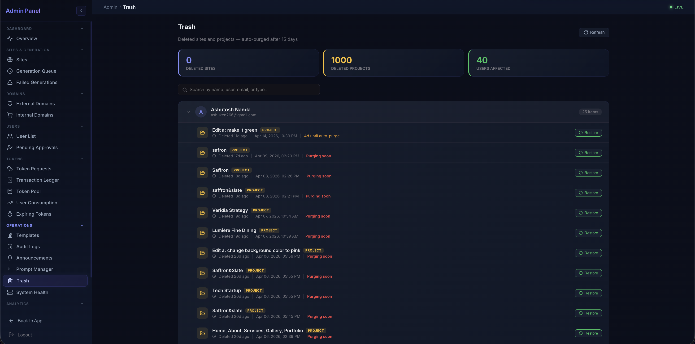
